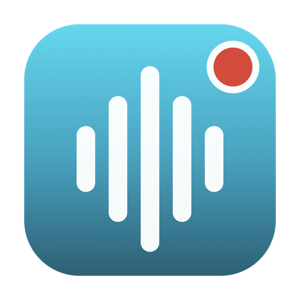
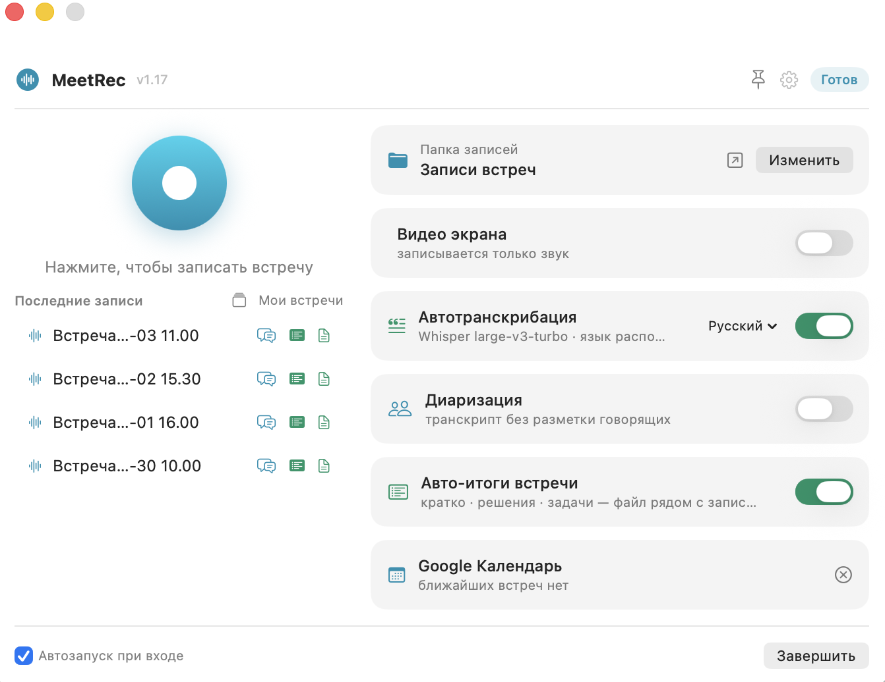

<div align="center">



# MeetRec

**Record your meetings on macOS — system audio and microphone in one file, with fully local transcription.**

[](https://github.com/chuck-uz/MeetRec/releases/latest)
[](#requirements)
[](#requirements)
[](LICENSE)

[Русская версия](README.md)



</div>

## Why MeetRec

Every meeting tool records only itself. MeetRec records **any** meeting — Zoom, Google Meet, Teams, a phone call in your browser — because it captures the Mac's system audio together with your microphone and mixes them into a single `.m4a`. When the meeting ends, a text transcript with timestamps appears next to the recording. By default everything happens **on your Mac**: no servers, no subscriptions, nothing leaves your machine. If you want a stronger model, you can plug in Claude, OpenAI, DeepSeek or OpenRouter with your own API key; then only the meeting text goes to the provider, and the app says so explicitly.

## Features

- **One-click recording** — the "Записать" button on the "Новая запись" screen, or start straight from the menu bar; a live timer sits next to the clock. Per-meeting options (captions, speakers, voices, summary, video) are chips under the title.
- **System audio + microphone** captured simultaneously via ScreenCaptureKit and mixed into one stereo AAC file (48 kHz).
- **Pause & resume recording** — a pause button in the window and the menu bar; the paused interval is cut out of the final file, so the timeline stays seamless — no silence gap. Works for both audio and screen video.
- **Local transcription** — [whisper.cpp](https://github.com/ggml-org/whisper.cpp) with the `large-v3-turbo` model, Metal-accelerated. An hour of audio takes ~4–6 minutes in the background. Language is auto-detected (Russian, English, and 90+ others).
- **Timestamped Markdown transcripts** (`[03:12] …`) saved next to each recording — ready to paste into your favorite LLM.
- **Speaker diarization (optional)** — transcripts as a dialog, «Спикер 1 / Спикер 2…» ([FluidAudio](https://github.com/FluidInference/FluidAudio), CoreML, fully on-device; ~30 MB models download automatically).
- **Live captions with translation (optional)** — while recording, the conversation appears in the main window a few seconds behind, with foreign speech translated into your language by the selected model. The "Поверх экрана" button opens the captions in a panel over all windows (including full-screen Zoom) that never takes focus and is excluded from screen sharing; captions are saved to `… — субтитры.md`.
- **Voice recognition (optional)** — your own lines are labeled "Я" from the microphone track; name the other speakers on the meeting screen and their names are filled in automatically in later meetings (marked with a similarity score, easy to fix). Only voice prints are stored — no audio, on your Mac only.
- **AI chat per meeting** (Macs with 16+ GB memory, or an external model) — summaries, action items, decisions, follow-up drafts or free-form questions over any transcript. Qwen 2.5 via bundled [llama.cpp](https://github.com/ggml-org/llama.cpp) (Metal); the model downloads on first use and unloads after 5 idle minutes. With the local model, answers never leave your Mac. Summaries and answers can be selected as a whole or copied with one button.
- **Model picker tuned to your hardware** (Settings → "Модель ИИ") — Qwen 2.5 **3B / 7B / 14B** with a hint of what suits your Mac by unified memory: "Рекомендуется", "Доступно", "Впритык" or "Не хватит памяти". The recommended model for your Mac is selected by default; the first download (which can be ~9 GB) asks for confirmation. Pre-download a model or delete it to reclaim disk.
- **Global archive search (local RAG)** (Macs with 16+ GB memory) — ask one question across *all* meetings and get an answer with cited sources. Transcripts are chunked, embedded with [bge-m3](https://huggingface.co/BAAI/bge-m3) and stored in a local SQLite index (FTS5 keyword + vector search, fused via RRF); the same local Qwen writes the answer. Nothing leaves your Mac.
- **Automatic meeting summary (optional)** (Macs with 16+ GB memory) — after transcription the local model writes a structured summary (brief / decisions / action items) into a companion `… — итоги.md` next to the recording. Zero clicks from recording to action items.
- **External models with your API key (optional)** — Claude, OpenAI, DeepSeek or OpenRouter instead of the local model: for summaries, chat, archive answers and caption translation. The key is stored in the macOS Keychain; switch models right under the question field. Only text goes to the provider (transcript, your questions, lines to translate) — audio, speech recognition, voice prints and the search index stay on the Mac. Also works on Macs with less than 16 GB.
- **Glossary** — list the system names and surnames that speech recognition gets wrong; they are passed as a hint to Whisper and to the model, and garbled names in summaries are corrected from context.
- **One window** — meetings grouped by date on the left; on the right the selected meeting: summary and chat, transcript with a player (click a timestamp to seek), captions, speakers. Recording, archive search, voices and settings live in the same window.
- **Self-updating model** — the app checks [`models.json`](models.json) daily and downloads the newer recommended Whisper model automatically.
- **Check for updates** — a daily check against GitHub releases surfaces an "обновить" badge; the current version is shown in Settings.
- **Google Drive aware** — if Google Drive for desktop is installed, recordings go to *My Drive → Записи встреч* and sync to the cloud automatically.
- **Google Calendar integration** — recordings are named after the current meeting, attendees go into the transcript header, and a "Meeting started" notification offers one-click recording. See [setup below](#google-calendar-optional).
- **Screen video recording (optional)** — a toggle captures video at 30 fps (HEVC, hardware-encoded, ~0.7–1.5 GB/hour) alongside audio. Choose the **source**: the whole screen, a specific display, or a **single window**. When capturing a window, audio is still recorded in full (system + microphone), so the meeting audio is never lost even if you record a different window (a doc, slides). An `.mp4` with the mixed audio appears next to the `.m4a`; file size is shown live while recording.
- **Stays out of your way** — quick actions in the menu bar; always-on-top and launch-at-login are in Settings.

## Installation

1. Download `MeetRec.dmg` from the [latest release](https://github.com/chuck-uz/MeetRec/releases/latest).
2. Open it and drag **MeetRec** into **Applications**.
3. First launch: right-click → **Open** (the app is ad-hoc signed, so Gatekeeper asks once).
4. On the first recording, grant two permissions in *System Settings → Privacy & Security*:
   - **Screen & System Audio Recording** — to capture meeting audio;
   - **Microphone** — to capture your voice.

The Whisper model (~1.6 GB) is downloaded automatically before the first transcription, with progress shown in the app.

## Google Calendar (optional)

With the calendar connected, MeetRec:

- names recordings after the current meeting — "Platform sync — 2026-07-05 15.00.m4a" instead of a bare date;
- adds the meeting title, time and attendees to the transcript header;
- shows your next meeting in the window;
- sends a "Meeting started" notification with a one-click **Record** button.

Access is read-only (`calendar.readonly`); tokens are stored in the macOS Keychain and never leave your machine.

> **⏳ Status: the app is going through Google's verification process.** Until it
> completes, OAuth credentials are not bundled — each user needs their own (free)
> OAuth client. It takes ~10 minutes:
>
> 1. Create a project in the [Google Cloud Console](https://console.cloud.google.com) and enable the **Google Calendar API**.
> 2. Configure the OAuth consent screen (External) and publish it **In production**.
> 3. Create an OAuth client of type **Desktop app**.
> 4. Copy [google_oauth.example.json](google_oauth.example.json) to
>    `~/Library/Application Support/MeetRec/google_oauth.json` and fill in your `client_id` and `client_secret`.
> 5. Click **«Подключить»** in the calendar card in MeetRec; on the
>    "Google hasn't verified this app" warning choose *Advanced → Continue* (it's your own app).
>
> Once verification is complete, the calendar will work out of the box.

## Requirements

- macOS 15 Sequoia or newer
- Apple Silicon (built and tested on M-series)

## Usage

| Action | How |
|---|---|
| Start / stop recording | "Новая запись" → "Записать", or the menu bar icon → *Начать запись* |
| Pause / resume recording | "Пауза" on the recording screen (the paused gap is cut from the file) |
| Watch recording time | Timer appears in the menu bar next to the icon |
| Open a meeting | Click it in the list on the left |
| Transcribe an older recording | Open the meeting → "Расшифровать" |
| Label speakers in transcripts | "Говорящие" chip before recording |
| Chat with AI about a meeting | "Итоги и чат" tab on the meeting screen |
| Switch the AI model | The model menu under the question field, or Settings → "Модель ИИ" |
| Connect Claude / OpenAI / DeepSeek / OpenRouter | Settings → "Модель ИИ" → "Где работает ИИ", paste the API key |
| Search across all meetings | "Поиск по встречам" in the sidebar |
| Captions over Zoom | "Поверх экрана" button while recording |
| Fix spelling of terms and surnames | Settings → "Словарь" |
| Change output folder | Settings → "Папка записей" → *Изменить* |
| Record screen video | "Видео" chip before starting |

## How it works

```
ScreenCaptureKit ──► system audio ─┐
                                   ├─► AVAssetWriter (.mov, 2 tracks) ─► mixdown ─► .m4a
AVFoundation ──────► microphone  ──┘                                                 │
                                                                                     ▼
                                              whisper.cpp (Metal) ─► transcript .md with timestamps
```

- The recorder writes the sources as separate tracks (plus a video track when enabled) and mixes them down on stop; if the mixdown ever fails, the raw multi-track file is kept, so a recording is never lost.
- `whisper-cli` is statically compiled (Metal embedded, system frameworks only) and bundled inside the app — the DMG is fully self-contained.
- Transcription runs `afconvert` → `whisper-cli` → JSON → Markdown, entirely offline.

## For developers

In-depth technical documentation:

- **[ARCHITECTURE.md](ARCHITECTURE.md)** — system design: the pipeline, every
  subsystem (recording, transcription, diarization, local LLM, RAG search,
  calendar), data model, concurrency, key decisions.
- **[CONTRIBUTING.md](CONTRIBUTING.md)** — build, run, add a feature, release;
  conventions and code signing.

## Building from source

```sh
git clone https://github.com/chuck-uz/MeetRec.git
cd MeetRec
./build.sh        # produces build/MeetRec.app and dist/MeetRec.dmg
```

Requires Xcode Command Line Tools. The bundled `app/bin/whisper-cli` is a static universal-free arm64 build of whisper.cpp (`cmake -DBUILD_SHARED_LIBS=OFF -DGGML_METAL=ON -DGGML_METAL_EMBED_LIBRARY=ON`); rebuild it the same way if you want to bump whisper.cpp.

A minimal CLI variant also lives in the repo: `swiftc -O -parse-as-library MeetRec.swift -o meetrec && ./meetrec`.

## Privacy

MeetRec only goes online to fetch models (Whisper and diarization — from Hugging Face, once) and the recommended-models manifest `models.json` in this repository; with Google Calendar connected, it also calls the Calendar API (read-only). Audio, transcripts, captions and voice prints never leave your Mac. A voice print is biometric data: enable voice recognition with participants' consent. Always make sure recording meetings is legal in your jurisdiction and that participants are informed.

The one exception is when you choose an external model in Settings → \"Модель ИИ\": then the transcript text, your questions and the lines to translate are sent to the selected provider (Anthropic, OpenAI, DeepSeek or OpenRouter) with your API key. Audio, video, voice prints and the search index are never sent. The key is stored in the macOS Keychain.

## License

[MIT](LICENSE)
